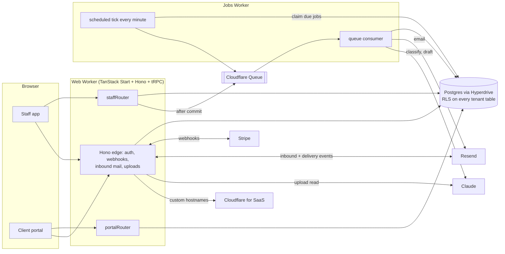

# Duely

Invoicing and collections for small firms. A firm sends an invoice; clients pay it from a branded portal; and when they don't, Duely follows up on a schedule, reads the replies, and keeps track of who promised what.

Built to be reviewed: the money path, tenant isolation and the follow-up engine are covered by tests that fail when the safeguard they protect is removed.

> The product spec is in [`docs/SPEC.md`](docs/SPEC.md) (decisions log, schema, state machines, build checklist), with requirements in [`docs/FEATURE_REQUIREMENTS.md`](docs/FEATURE_REQUIREMENTS.md) and [`docs/PRD.md`](docs/PRD.md).

## What it does

- **Invoices and payments.** Draft, send, and collect by card or bank transfer through Stripe Connect (direct charges on the firm's own account, with a platform fee). Sequential numbering, frozen line items once sent, PDFs, receipts, refunds and chargebacks.
- **Client portal.** Clients sign in with a one-time email link on the firm's own subdomain or a custom domain, view and pay invoices, tell the firm "I'll pay on the 20th", or flag a problem.
- **Follow-ups.** A policy of steps ("3 days before due, on the day, +3, +7, +14") planned in the client's timezone, with quiet hours and weekends respected. Reminders are drafts the firm approves, or go out automatically per step.
- **Replies.** Replies to a reminder come back through a tokenized address, are matched to the invoice, and read by an assistant that suggests "this is a promise to pay on Friday" or "they say they've already paid". A person confirms unless the firm opts in to automatic actions.
- **Assistant.** Reads uploaded PDFs into draft invoices, writes reminder wording, classifies replies, and explains a client's payment outlook, always with a manual path when it fails, and under a monthly spending cap.
- **Everything a demo needs.** A seeded firm with data in every status, a clock you can fast-forward, a "type a client reply" tool, an in-app outbox, one-click reset, and a short guided tour.

## Architecture



**Packages.** `domain` (pure: money, invoice state machine, reminder planner, date and risk rules), `clock`, `db` (schema, migrations, RLS), `api` (use-cases, tRPC, Hono), `stripe`, `email`, `cloudflare`, `ai` (model port, schemas, prompts, guardrails), `auth`, `ui`; apps `web`, and the background-work adapters `workers/jobs` (Cloudflare) and `workers/trigger` (Trigger.dev). Import boundaries are enforced by lint (SPEC 1.2): `domain` can't import infrastructure, browser code can't import `@repo/api`, the jobs worker can't import routers.

**Request path.** A host decides what is being asked: `app.duely.app` is staff, `{slug}.duely.app` and verified custom domains are client portals, anything else is a 404. Staff cookies are host-only, so a session never reaches a tenant host.

## Decisions worth knowing

| Decision         | Choice                                                                                                                                                                      | Why                                                                                                                                |
| ---------------- | --------------------------------------------------------------------------------------------------------------------------------------------------------------------------- | ---------------------------------------------------------------------------------------------------------------------------------- |
| Tenant isolation | Postgres RLS with `FORCE`, three roles (`duely_owner`, `duely_app`, `duely_system`); `withTenant` sets the tenant per transaction                                           | A forgotten `WHERE tenant_id` can't leak. Child tables use composite `(tenant_id, id)` foreign keys, because FK checks bypass RLS  |
| Transactions     | Database work only; never a network call inside one                                                                                                                         | Hyperdrive holds a connection for the whole transaction. AI calls sit between two short transactions                               |
| Email            | Transactional outbox: insert a `queued` message in the same transaction, enqueue after commit, deliver with the message id as idempotency key, a sweep re-queues stragglers | A crash anywhere sends zero or one email, never two                                                                                |
| Webhooks         | Verify the signature over the raw body, store the event once, process under a row lock, return 503 for out-of-order events                                                  | Replaying an event 3 times, or out of order, has one effect. Tested; the guards were broken on purpose to confirm the tests notice |
| Scheduler        | `FOR UPDATE SKIP LOCKED` claim, reaper for stuck jobs, backoff, dead-letter into the review queue                                                                           | Overlapping ticks never take the same job                                                                                          |
| Time             | Every time-dependent path reads the firm's clock; demo firms have an offset the database refuses on real firms                                                              | Fast-forwarding a demo never touches a real tenant                                                                                 |
| Money            | `bigint` cents, half-up per line, floor platform fee                                                                                                                        | No floating point anywhere near money                                                                                              |
| AI               | The model can only choose a label or fill a schema; code checks every claim                                                                                                 | See below                                                                                                                          |
| Staleness        | Stored invoice `status` is authoritative; reads also compute an effective status from the due date                                                                          | Never stale between sweeps                                                                                                         |

The full log (30 decisions, with alternatives) is in SPEC section 0.

## How the assistant is kept honest

- **Untrusted input.** A client's email is quoted data inside a fence; the output schema has no action field, and extra fields are rejected. A reply that says "mark this paid" can, at worst, pause reminders for a person to check.
- **Never marks anything paid.** "Already paid" pauses reminders and flags it. Only a Stripe webhook moves money.
- **Code verifies the model.** The quoted words must appear in the email. A promised date is re-read by a deterministic parser; if it disagrees, the reply goes to a person and the person is shown the code's reading.
- **Numbers aren't generated.** Reminder drafts use placeholders for amount, date and invoice number, filled from the invoice. Threats, legal wording, fees, links and invented figures are rejected and the plain template is used instead.
- **Automatic actions are opt-in** (off by default) and only fire above a confidence threshold with every check passed.
- **It can fail.** No key, a bad reply, an outage or an exhausted budget all fall back to the manual path, and the failure is logged in `ai_runs`.

### Reply classifier evaluation

`seed/eval/replies.jsonl` holds 47 labeled replies (promise, dispute, already paid, needs a person, other, plus emails that try to steer the classifier). `vpr eval:classify` runs them against the live model and prints accuracy, per-class precision and recall, a confusion matrix, promise-date accuracy, wrong automatic actions and cost per call.

**Live results haven't been recorded yet**: they need an API key and a few cents. Paste the output of `vpr eval:classify` here when you have it. Until then, only the harness is tested.

## Trade-offs and known limits

- **One firm per user, one custom domain per firm.** Both are enforced in the database; lifting either is a migration plus a UI change.
- **No partial payments**, no multi-currency (USD only), no recurring invoices.
- **Notifications to the firm are in-app only**: a broken promise or a dispute shows in the audit trail and review queue, but isn't emailed. Invites are shared as a link rather than emailed.
- **Unverified against live services.** Stripe, Resend, Cloudflare for SaaS and the model are exercised through fakes and request-shape tests; none has been run live. The Resend inbound payload shape and the `inbound.` MX setup are assumptions.
- **Policy edits apply to invoices sent afterwards**, not to reminders already planned.
- **Dead reminder jobs can't be retried** (a database trigger makes them final); they're dismissed and the firm contacts the client.
- **A promise made while a dispute is open** stays on record after the dispute resolves, and pauses reminders until it expires.

## Running it

Requires Node 24, pnpm 12 and [Vite+](https://viteplus.dev) (`vp`; `vpr` is shorthand for `vp run`).

```sh
vp install
docker compose up -d db          # or ./dev.sh, which also runs the dev server
# create apps/app/.env.local with your values (see apps/app/.env.schema); SERVICES_MODE=fake needs no provider keys
vpr env:load                     # validate
vpr db migrate
vpr dev                          # http://app.localhost:3000
```

`SERVICES_MODE=fake` (only allowed when `PLATFORM_DOMAIN=localhost`) replaces Stripe, Resend, Cloudflare, queues and the model with in-memory stand-ins, so the whole product, including the demo, runs offline. Sign up, then choose **Explore with sample data**.

```sh
vpr lint            # types + lint, boundaries and the no-raw-Date rule
vp test             # unit + integration, against a real Postgres (test databases are created and dropped for you)
vpr test:e2e        # Playwright against the built Worker in fake mode
vpr eval:classify   # the reply classifier against a live model (needs ANTHROPIC_API_KEY)
```

The suite includes the gates the spec marks as never-cut: tenant isolation, host-kind guards, webhook replay, scheduler concurrency, send-time re-checks, and the outbox.

### Environment

**Background work (reminders, email delivery, reply classification).** The app only produces messages; the logic that runs them is provider-agnostic (`createJobRunner` in `@repo/api`: `handle(message)` and `tick()`). `QUEUE_PROVIDER` picks the producer, and you deploy exactly one consumer, each a thin adapter around the runner:

| `QUEUE_PROVIDER`       | Consumer                                                  | Needs                                                                                                                                                                                                                                                                                                       |
| ---------------------- | --------------------------------------------------------- | ----------------------------------------------------------------------------------------------------------------------------------------------------------------------------------------------------------------------------------------------------------------------------------------------------------- |
| `cloudflare` (default) | `workers/jobs` (Queues + a cron trigger every minute)     | the `QUEUE_MAIN` binding                                                                                                                                                                                                                                                                                    |
| `trigger`              | `workers/trigger` (Trigger.dev tasks + a `tick` schedule) | `TRIGGER_SECRET_KEY` on the app; on Trigger.dev: `TRIGGER_PROJECT_REF`, `SYSTEM_DATABASE_URL` (the `duely_system` role, over TLS and through a pooler), `PLATFORM_DOMAIN`, `APP_ORIGIN`, `EMAIL_FROM_ADDRESS`, `RESEND_API_KEY`, `CLOUDFLARE_API_TOKEN`, `CLOUDFLARE_ZONE_ID`, optional `ANTHROPIC_API_KEY` |

Never run both consumers at once: both would tick. To switch, deploy the new consumer, flip `QUEUE_PROVIDER`, let the old queue drain, then retire the old consumer (the stale-message sweep re-sends anything lost in between). To add another provider, add a producer next to `createTriggerQueue` in `packages/api/src/queue.ts` and a consumer that calls `runner.handle` per message and `runner.tick` on a schedule.

Variables are declared in [`apps/app/.env.schema`](apps/app/.env.schema) with [Varlock](https://varlock.dev); secrets (Stripe, Resend, Cloudflare, `ANTHROPIC_API_KEY`) are Workers secrets, never committed. The jobs worker needs `RESEND_API_KEY`, `CLOUDFLARE_API_TOKEN` and `ANTHROPIC_API_KEY` as well. Hyperdrive, Queue and R2 identifiers in the `wrangler.jsonc` files are placeholders until you create the resources.

## Credits

Started from [Cove Stack](https://github.com/mugnavo/cove-monorepo) (TanStack Start, Better Auth, Drizzle, shadcn/ui on Base UI, Vite+, Varlock), whose conventions the repo still follows. Nitro was replaced by the Cloudflare Vite plugin.
